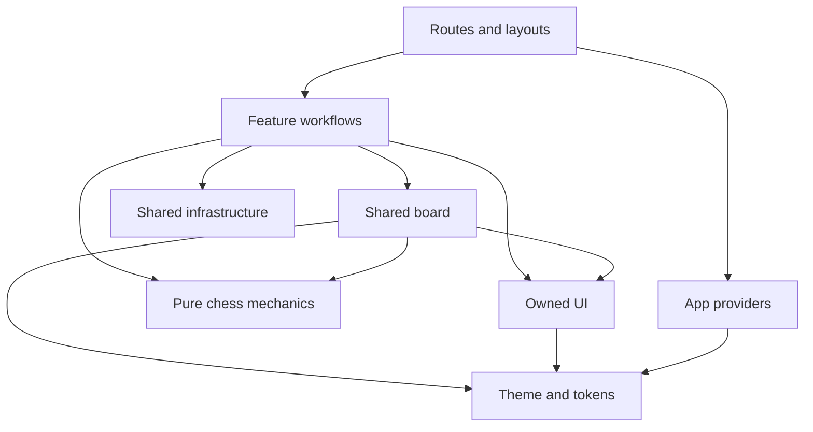

# Knightly architecture

Navigation map of accepted ownership. [Technology decisions](docs/technology-decisions.md) and the
linked specifications hold the detailed rationale and behavior. This map does
not introduce new layers or claim planned integrations are implemented.

## Application boundary

One Expo application and npm package targets iOS, Android and web through Expo
Router. Share route identity and domain logic; adapt navigation, layout and input
where platforms differ. The retained FastAPI backend lives in `backend/`; the original web
app stays in the original repository. The first release is online-only; bounded
read-only startup caching is supported, while offline queues, local
practice databases and PowerSync are deferred.

## Ownership map

| Location | Responsibility | Boundary |
| --- | --- | --- |
| `backend/` | FastAPI, CLI, analysis, worker, migrations and canonical learning | Independent Python package; communicates with clients over HTTP. |
| `deploy/`, `infra/` | Server image operation, backups and existing infrastructure | Preserve database/identity resources; deployment handoff is explicit. |
| `src/app/` | Router entry points, layouts and screen composition | Delegate product workflows to features; the home route composes authenticated Today. |
| `src/features/` | Screens, feature state, API/query hooks, progression and submissions | Contains board-lab, shell, account, Today, practice, review, Progress and Chess.com import/Games; see the [feature map](#feature-map). Reuse another feature through a deliberate public interface, never private files. |
| `src/chess/` | Pure position/coordinate/move helpers and shared board | Mechanics use chess.js; board receives plain data/callbacks. No feature, auth or backend dependencies. |
| `src/ui/`, `src/components/ui/`, `src/theme/` | Public UI entry; owned reusable controls; tokens, semantic themes, fonts and visual providers | Features and routes import shared UI only through `src/ui` (SwiftUI pieces through `src/ui/native-settings`); see the [design system](docs/specs/2026-10-10-app-foundation-design.md#shared-design-system). Styling is React Native `StyleSheet` themed through `src/theme/theme.tsx` (`createStyles`/`useTheme`). No feature workflows. |
| `src/lib/` | Shared config, auth, transport and Query infrastructure | No feature screens; owns configuration, Clerk sessions, transport and API response decoding. Game analysis runs on the backend; `src/lib/engine/` evaluates review side lines on the device (a web worker, and the `modules/stockfish` Expo module on iOS/Android). |

Tests and stories live beside the code they exercise. `test/setup.ts` owns Jest
bridge mocks; `.storybook/` and `.rnstorybook/` configure the shared gallery.
Native project directories are generated from Expo configuration, not maintained
as the source of truth. Asset attribution lives in [licenses](assets/licenses/README.md).

Allowed dependency direction, including implemented infrastructure:

Shared production code does not depend back on routes or features. Cycles are
disallowed; blanket barrel exports and service/repository layers are not required.
Run `npm run architecture:check` to enforce the import rules below. Both aggregate
verification commands and the quality workflow include it.

## Feature map

Where to start for each feature folder under `src/features/`. Public API files are
the only cross-feature entry points (registered in `architecture.config.json`);
HTTP calls go through `src/lib/api/`. Backend modules are under
`backend/src/knightly/`: the routes are in `routes/` (named in the last column), their
request and response models in `schemas.py`, and `api.py` only builds the app.

| Feature | Specs | Public API | Backend modules |
| --- | --- | --- | --- |
| `account` | [navigation and settings](docs/specs/2026-10-12-knightly-navigation-design.md) | `account-api.ts` | `routes/account`, `users`, `export`, `schedule`, `update`, `limits`, `welcome` |
| `board-lab` | [chessboard](docs/specs/2026-10-10-universal-chessboard-design.md), [layered board](docs/specs/2026-10-15-layered-board-design.md) | none (development only) | none |
| `games` | [Games](docs/specs/2026-10-12-games-design.md), [Chess.com import](docs/chesscom-import.md) | `games-api.ts` | `routes/games`, `game_facts`, `lookup`, `jobs`, `sources/`, `update`, `welcome` |
| `practice` | [daily practice](docs/specs/2026-10-11-daily-practice-design.md), [instant practice](docs/specs/2026-10-15-instant-practice-design.md), [answer feedback](docs/specs/2026-10-14-answer-feedback-design.md), [coaching](docs/specs/2026-10-15-coaching-explanations-design.md), [safety habits](docs/specs/2026-10-16-safety-habit-training-design.md), [blunder causes](docs/specs/2026-10-16-blunder-causes-design.md), [weakness model](docs/specs/2026-10-17-weakness-model-design.md) | `practice-api.ts` | `routes/practice`, `routes/puzzles`, `deck`, `practice_lines`, `practice_grades`, `puzzles`, `drill`, `unannounced`, `causes`, `patterns`, `timing` |
| `progress` | [Progress](docs/specs/2026-10-11-progress-design.md) | none | `routes/progress`, `game_facts`, `game_trend`, `layers`, `skill_shape`, `time_management`, `patterns` |
| `review` | [game review](docs/specs/2026-10-11-game-review-design.md), [review deck quality](docs/specs/2026-10-16-review-deck-quality-design.md) | none | `routes/games`, `game_facts`, `lines`, `positions`, `causes`, `layers`, `deck` |
| `shell` | [foundation](docs/specs/2026-10-10-app-foundation-design.md), [navigation](docs/specs/2026-10-12-knightly-navigation-design.md) | none | `routes/account`, `jobs`, `update` (import status) |
| `today` | [Today daily review](docs/specs/2026-10-13-today-daily-review-design.md), [session-end beats](docs/specs/2026-10-14-session-end-beats-design.md), [learning loop](docs/specs/2026-10-17-learning-loop-design.md) | `today-api.ts` | `routes/home`, `daily`, `deck`, `units`, `game_facts`, `puzzles`, `patterns`, `game_trend` |

## Executable import rules

The [checker](scripts/check-architecture.mjs) uses the installed TypeScript parser,
the project's inherited tsconfig paths and module resolution, and separate web,
iOS and Android graphs. It scans TypeScript/JavaScript source under `src/`, including
tests, stories and declarations. It reads import/export declarations, import types,
import-equals, and literal `require()`/dynamic imports; comments and strings are not
imports. Type-only edges count for both boundaries and cycles.

- Expo source cannot import files from `backend/`, including assets
  or development examples. Keep reusable frontend assets owned here and access
  backend behavior through the HTTP contract.
- Shared `chess`, `components`, `ui`, `theme` and `lib` production modules cannot import
  feature workflows or routes. Chess production modules cannot import `lib`.
- Pure chess outside `chess/board` cannot import rendering, UI/theme or infrastructure,
  or known React/Expo/auth/query/transport packages. The existing explicit type-only
  dependency on `chess/board/board.types.ts` is allowed; importing its board renderer
  barrel is not a substitute. Extract reusable domain types if this exception grows.
- A feature may import its own internals. Another feature may import only an
  intentional API file listed in [architecture.config.json](architecture.config.json).
  Routes may compose feature screens directly. Account layout/settings screens,
  Games import progress, practice sessions and Today screens/reminders have
  explicit public API files; registering a file is an explicit ownership decision, not an automatic
  exemption for everything named `index.ts`.
- Shared tests/stories may compose feature demos, preserving the existing gallery.
  Production modules cannot import test/story modules. Cross-feature private
  imports remain restricted even in tests/stories.
- Circular dependencies fail with a witnessed file chain and the affected platform.
  Relative imports and tsconfig aliases resolve through `.web`, `.ios`/`.native`
  and `.android`/`.native` variants before the base module. Direct imports of an
  incompatible variant fail. Fallback source files are also checked, even when
  shadowed by a platform variant; unused source does not escape the rules.

To expose an API, add its existing repository-relative file path to
`featurePublicFiles`, for example `src/features/account/account-api.ts` once that
file exists. Its platform siblings share that public identity. Re-export private
implementation deliberately through that API; callers still cannot import the
private implementation directly. Entries must be production source files in the
owning feature, and stale/missing entries fail.

Computed import/require paths and unresolved relative/alias imports fail rather
than silently disappearing from the graph. Existing asset files are leaf dependencies.
Source symlinks are unsupported. External package internals and arbitrary runtime
calls such as `fetch()` are outside this static import check; it does not prove
server isolation, absence of network behavior or exact Metro bundling. Typechecking,
code review and affected-platform runtime checks remain necessary.

## Board data flow

A feature supplies `Position` (logical ID and FEN), orientation, policy and
presentation to `Chessboard`. The board owns selection, drag, keyboard focus and
promotion UI. Tap/drag/keyboard/accessibility converge on `onAttempt`, carrying
the originating position ID and local attempt ID. The feature settles correlated
feedback and commits canonical positions; legal eligibility is separate from
visible hints and from correct practice answers.

Navigation/reset invalidates stale interaction even when FEN repeats. Async
features must guard late results against the active session/position/attempt;
local IDs do not establish server idempotency. Grading, scheduling and history
remain outside the board. Chess.js handles standard chess mechanics,
not analysis or learning; repetition requires history beyond the current FEN.

Start at [board contracts](src/chess/board/board.types.ts),
[position boundary](src/chess/position.ts), [move helpers](src/chess/move.ts),
and the [approved board specification](docs/specs/2026-10-10-universal-chessboard-design.md).
The [board lab](src/features/board-lab/use-board-demo.ts) is a local consumer
example, not production grading or backend integration.

## Application foundation

The [foundation specification](docs/specs/2026-10-10-app-foundation-design.md)
defines responsive navigation, Clerk sign-in, typed backend bootstrap, Today and
Account. Today is the landing destination, beside Games and Progress. Knightly has no
bot play. Practice/review are focused
experiences. Unsupported actions stay unavailable rather than simulating lessons.

Implemented ownership: TanStack Query handles server state; React
state/reducers handle interface state. Shared transport uses FastAPI OpenAPI types
and openapi-fetch, with Zod validation at consumed boundaries. Clerk owns token
persistence (SecureStore on native); AsyncStorage holds display preferences,
validated public configuration and bounded read-only account snapshots. Shared
Query infrastructure restores selected Today/Games/Progress reads before network
refresh, with a 24-hour expiry and API/user/session isolation. Authenticated
caches and in-flight responses must be isolated across
accounts. The integration consumes `/api/config`, `/api/me` and the existing Chess.com
lookup/account/import/status/Games and deck/answer/hint endpoints.
`src/features/practice/` owns daily sessions, correlated board attempts, hints,
in-memory redos and ambiguous-save recovery; its registered `practice-api.ts`
exposes hide reasons. Practice and review sessions share `src/lib/lesson-session.ts`
(store, points, timers, punishing reply, save-rejection rule), are kept per account
scope by `src/lib/use-scoped-session.ts`, refresh account queries through the groups
in `src/lib/account-queries.ts` and render through the shared `LessonFrame`; each
feature builds its board in a pure selector. The backend owns grading and
canonical progress. `src/features/review/` owns SAN replay, guided key moments,
correlated grading, optional engine explanations and explicit review completion.
It consumes game-detail, engine-lines and review-save endpoints through the same
session lifetime. `src/features/progress/` owns authenticated overview/patterns,
ordered home units and deck summaries, with per-session/range Query keys. Backend
counts, unit completion/order and grading remain authoritative; chart smoothing
and selection are presentation state. Unit/opening links use validated Games
filters, and acknowledged saves/import updates invalidate summaries. See the
[Progress specification](docs/specs/2026-10-11-progress-design.md).
Shared response schemas live in `src/lib/api/`; features
own the consuming workflows. Backend contract/CORS changes are retained in `backend/`. The original Git
history is preserved as the second parent of the consolidation merge; active
files are relocated without importing the original mobile app or historical plans.

React Hook Form/Zod forms, Sentry error reporting and EAS release tooling are
accepted directions; forms and Sentry remain unconfigured. EAS internal preview
builds are configured for the hosted backend. Clerk, Query,
openapi-fetch and Zod are installed. Consult
`package.json`, the [foundation specification](docs/specs/2026-10-10-app-foundation-design.md)
and the decision ledger before adding packages or enabling features.

## Verification and source of truth

Use [README commands](README.md) and [current status](docs/status.md).
Web adapters need browser checks; native adapters need native runtime checks.
Jest uses bridge mocks and platform exports only establish bundling. Spoken
VoiceOver/TalkBack and native hardware-keyboard gates remain explicit.

Use the [document index](docs/index.md) to locate accepted requirements,
specifications and current status. Current source/configuration and recorded checks establish implementation status. If implementation disagrees with approved
behavior, surface the discrepancy rather than silently treating code as approval
for a new decision.
